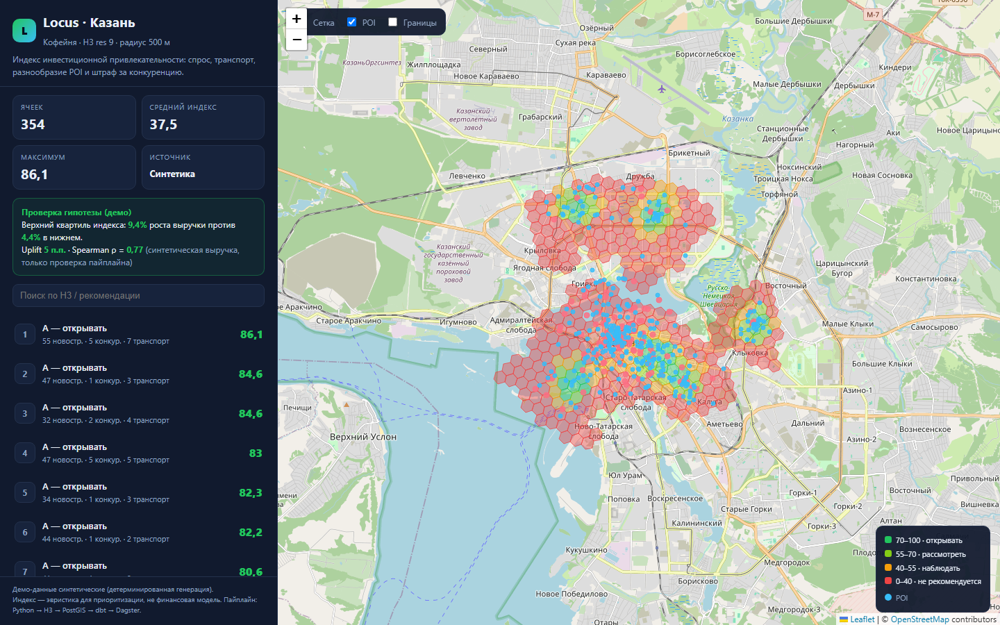
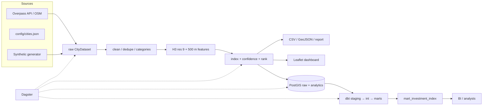

# Locus — индекс инвестиционной привлекательности локаций

Pet-project продуктового data engineer: пайплайн собирает городские данные
(OpenStreetMap / открытые данные), считает спрос и конкуренцию вокруг каждой
точки и строит **индекс инвестиционной привлекательности** для открытия
кофейни или ПВЗ.

> **Демо:** [`docs/demo/dashboard.html`](docs/demo/dashboard.html) — интерактивная
> карта 354 H3-ячеек Казани для кофейни. Вариант для ПВЗ:
> [`docs/demo/dashboard_pvz.html`](docs/demo/dashboard_pvz.html). Данные
> синтетические (детерминированная генерация), чтобы проект запускался одной
> командой без Docker и сети.



## Гипотеза

> Локации с высокой плотностью новостроек, но низким количеством конкурентов
> в радиусе 500 метров показывают более высокий рост выручки.

Пайплайн проверяет её на размеченных данных: считает индекс, делит ячейки на
квартили и сравнивает рост выручки в верхнем и нижнем квартилях (uplift + Spearman ρ).
В демо-режиме выручка синтетическая — это проверка механики, а не доказательство
гипотезы. Колонка `observed_revenue_growth_pct` заменяется на реальные данные.

## Что реализовано

- **Extract:** Overpass API (POI, здания, остановки) + генератор синтетического города.
- **Transform:** очистка, нормализация категорий, дедупликация POI, H3-сетка.
- **Features:** спрос, население, новостройки, конкуренты, транспорт, разнообразие POI.
- **Index:** 0–100, компоненты, confidence, рекомендации A/B/C/D.
- **Load:** PostgreSQL + PostGIS, GiST-индексы, идемпотентные upsert'ы.
- **Warehouse:** dbt staging → intermediate → marts, тесты, витрина по двум бизнесам.
- **Orchestration:** Dagster assets, demo-job и warehouse-job, ежедневное расписание.
- **Serving:** standalone Leaflet-дашборд + JSON API без внешних Python-зависимостей.
- **Quality:** 31 pytest-тест, GitHub Actions CI.

## Архитектура



Подробнее: [`docs/architecture.md`](docs/architecture.md) и
[`docs/methodology.md`](docs/methodology.md).

## Быстрый старт (без Docker)

Нужен Python 3.11+.

```bash
python -m venv .venv
# Windows: .venv\Scripts\activate
source .venv/bin/activate

pip install -e ".[dev]"

# 1. Синтетический город + индекс + дашборд
locus demo --city kazan

# 2. Открыть дашборд и JSON API
locus serve --dir data/processed --open
# http://127.0.0.1:8000/
# http://127.0.0.1:8000/api/summary
# http://127.0.0.1:8000/api/locations
```

Команда создаёт:

| Файл | Что внутри |
|------|------------|
| `data/processed/location_index.csv` | все ячейки и компоненты индекса |
| `data/processed/location_index.geojson` | H3-полигоны для QGIS/BI |
| `data/processed/pois.geojson` | POI с флагом конкурента |
| `data/processed/summary.json` | метрики, топ, проверка гипотезы |
| `data/processed/report.md` | Markdown-отчёт |
| `data/processed/dashboard.html` | автономная карта |

Пример вывода:

```
Город: Казань · Кофейня
Ячеек: 354 · средний индекс: 37.49 · максимум: 86.11
Гипотеза (синтетика): uplift 5.01 п.п., Spearman ρ = 0.769

Топ-5 локаций:
  #1   8910a81017bffff  индекс  86.1  A — открывать  новостройки 55, конкурентов 5
  #2   8910a810013ffff  индекс  84.6  A — открывать  новостройки 47, конкурентов 1
```

## CLI

```bash
locus demo --city kazan --business-type coffee
locus demo --city kazan --business-type parcel_locker --out data/pvz
locus demo --source osm --city kazan          # реальные данные Overpass
locus extract --city kazan --out data/raw     # только извлечение
locus build --input data/processed/kazan_raw.json --business-type coffee
locus load --input data/processed/kazan_raw.json   # + PostGIS
locus serve --dir data/processed --port 8000
```

Основные флаги: `--resolution` (H3 4–12), `--radius` (метры),
`--business-type` (`coffee` / `parcel_locker`), `--seed`, `--no-revenue`.
Конфигурация — в `config/*.json` и переменных окружения из `.env.example`.

## Production path: PostGIS + dbt + Dagster

```bash
docker compose up -d postgis

pip install -e ".[db,orchestration]"

# 1. Извлечь реальные данные
locus extract --city kazan --out data/raw

# 2. Посчитать индекс и загрузить в PostGIS
locus load --input data/raw/kazan_raw.json --business-type coffee

# 3. Построить витрины
cd dbt
dbt run --profiles-dir .
dbt test --profiles-dir .

# 4. Оркестрация
cd ..
dagster dev -m orchestration.definitions
```

`dbt` создаст схемы `locus_staging`, `locus_intermediate`, `locus_marts` (по
умолчанию dbt добавляет префикс проекта). Итоговая витрина:
`locus_marts.mart_investment_index`.

Dagster:

- `demo_refresh` — synthetic/OSM → index → dashboard (без БД);
- `warehouse_refresh` — extract → PostGIS → dbt → dashboard;
- `daily_warehouse_refresh` — ежедневно в 03:00 Europe/Moscow.

## Формула индекса

Все компоненты нормируются в 0…1 по городу (min–max с отсечением верхних 5%
выбросов в Python-версии):

```
demand      = 0.50 × new_residential_units + 0.30 × new_buildings + 0.20 × population
access      = transport_stops
diversity   = distinct POI categories
competition = competitors in target categories

index = 100 × (w_demand×demand + w_access×access + w_diversity×diversity
               + w_competition×(1 − competition))
```

| Бизнес | demand | access | diversity | competition |
|--------|-------:|-------:|----------:|------------:|
| Кофейня | 0.45 | 0.20 | 0.10 | 0.25 |
| ПВЗ | 0.50 | 0.15 | 0.10 | 0.25 |

Рекомендации: **A** ≥ 70 — открывать, **B** 55–70 — рассмотреть,
**C** 40–55 — наблюдать, **D** < 40 — не рекомендуется. `confidence` растёт с
объёмом данных в радиусе. Формула и ограничения — в
[`docs/methodology.md`](docs/methodology.md).

## Структура проекта

```
config/                  города и типы бизнеса
src/locus/
  extract/osm.py         Overpass API
  synthetic.py           детерминированный демо-город
  cleaning.py            категории, дедупликация, валидация
  geo.py                 distance, bbox, H3, bucket index
  features.py            500 m агрегаты по H3
  scoring.py             индекс и рекомендации
  evaluation.py          квартили + Spearman
  pipeline.py            чистый Python-пайплайн
  export.py              CSV / GeoJSON / report
  dashboard.py           Leaflet HTML
  load/db.py             PostGIS DDL + upsert
  app/server.py          dashboard + JSON API
  cli.py                 CLI
dbt/                     staging → intermediate → marts + tests
orchestration/           Dagster definitions
docs/                    архитектура, методология, data dictionary, демо
tests/                   pytest
```

## Тесты

```bash
pytest
# или
pytest --cov=locus --cov-report=term-missing
```

CI: `.github/workflows/ci.yml` запускает тесты на Python 3.11–3.13.

## Ограничения

- OSM не содержит выручку, реальную проходимость, год постройки и число квартир
  для всех зданий. Пропуски обрабатываются эвристиками и снижают confidence.
- H3-биннинг выполняется в Python (в PostGIS нет нативных H3-функций), а
  радиусная агрегация — в PostGIS (`ST_DWithin` + GiST).
- Демо-данные синтетические. Метрики uplift на них — проверка пайплайна, не
  вывод о рынке.
- Индекс — инструмент приоритизации, а не замена финансовой модели.

## Roadmap

- Подключить реальные данные о новостройках (ДОМ.РФ / открытые данные города)
  и пассажиропоток транспорта.
- Isochrone-доступность вместо евклидова радиуса (pgRouting / OSRM).
- Инкрементальные dbt-модели и snapshot истории индекса.
- Загрузить реальные revenue-наблюдения и проверить uplift статистически.
- H3-агрегация на нескольких разрешениях и API для what-if сценариев.
