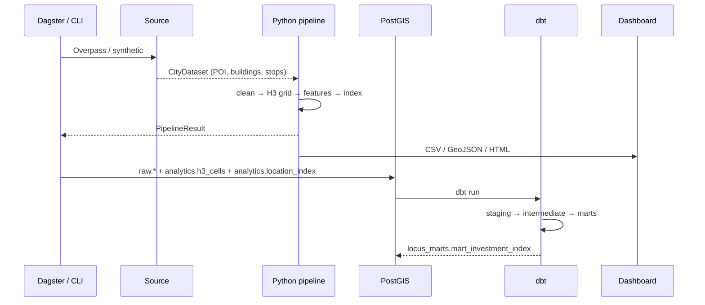

# Архитектура

## Поток данных



## Слои

### 1. Extract

- `locus extract` / `locus demo --source osm` — Overpass API.
- Запросы: POI (amenity/shop/leisure/office), здания, остановки транспорта.
- `locus demo` без `--source osm` — детерминированный синтетический город.
- Результат: `CityDataset` (dataclasses) → JSON в `data/raw/` или `data/processed/`.

### 2. Transform (Python)

- `cleaning.py`: валидация координат, нормализация OSM-тегов в канонические
  категории, дедупликация POI в пределах 50 м, ограничение этажности/годов.
- `geo.py`: haversine, fast distance, H3-сетка, `BucketIndex` для быстрых
  радиусных запросов без PostGIS.
- `features.py`: для каждой H3-ячейки собирает всё в радиусе 500 м.
- `scoring.py`: нормирует признаки и считает индекс.
- `evaluation.py`: квартили и Spearman для проверки гипотезы.

### 3. Load (PostGIS)

Схемы:

- `raw.pois`, `raw.buildings`, `raw.transport_stops` — исходные слои,
  `geometry(Point, 4326)`, GiST-индексы, PK `(city, id)`.
- `analytics.h3_cells` — H3-ячейки и полигоны (H3 считается в Python).
- `analytics.location_index` — витрина индекса по `(h3, business_type)`.

Загрузка идемпотентна: `DELETE` по городу + `INSERT ... ON CONFLICT`.
Пайплайн можно перезапускать без дублей.

### 4. Warehouse (dbt)

```text
sources (raw.*, analytics.h3_cells)
  └── staging: stg_pois, stg_buildings, stg_transport_stops, stg_h3_cells
        └── intermediate: int_cell_features
              └── marts: fct_location_index, mart_investment_index, dim_h3_cells
```

- `int_cell_features` делает radius-агрегацию через
  `ST_DWithin(geom::geography, geom::geography, 500)`.
- `fct_location_index` считает индекс для кофейни и ПВЗ (union двух бизнесов).
- `mart_investment_index` добавляет rank и рекомендации.
- Тесты: `not_null`, `unique`, `accepted_values`, 3 singular SQL-теста на
  границы индекса, уникальность `(h3, business_type)` и неотрицательность.

### 5. Orchestration (Dagster)

- `raw_city` → `cleaned_city` → `location_scores` → `dashboard`;
- `postgis_load` → `dbt_marts` — только в warehouse-job.
- Ресурс `LocusSettings` конфигурируется в UI/коде, значения по умолчанию
  совпадают с env-переменными.
- Расписание: `daily_warehouse_refresh` (03:00 Europe/Moscow).

## Масштабирование

- Python-пайплайн использует `BucketIndex` (lat/lon 0.01°) — быстрый вариант для
  города и демо. Для страны/нескольких городов агрегацию нужно делать в
  PostGIS/dbt, а не в памяти.
- GiST-индексы на `raw.*.geom` разгоняют `ST_DWithin`; при росте объёма —
  партиционирование по городу и BRIN/кластеризация по дате загрузки.
- H3-разрешение — параметр (`4–12`). Res 9 ≈ 0.105 км², удобно для 500 м.
- Для инкрементальности: dbt `incremental` по `city` + `computed_at`,
  snapshot истории индекса, Dagster partitions по городам/датам.
- Для реальных isochrone-радиусов: pgRouting/OSRM, вместо `ST_DWithin` —
  таблица достижимых H3-ячеек за N минут.

## Отказоустойчивость

- Overpass: retry с экспоненциальной задержкой, таймауты, fallback на демо.
- dbt-тесты валят пайплайн при выходе индекса за границы.
- Dagster retry policy можно добавить на asset-level; сейчас ошибки видны в UI
  и не публикуют частичную витрину (dbt run транзакционен на уровне моделей).
- Dashboard/CSV можно пересобрать из `location_scores` без БД.
