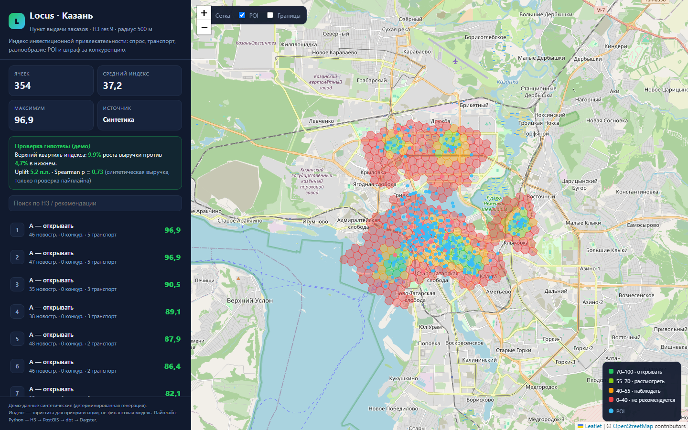

# Locus demo

Автономные Leaflet-дашборды, сгенерированные из синтетических данных Казани:

- [`dashboard.html`](dashboard.html) — кофейня;
- [`dashboard_pvz.html`](dashboard_pvz.html) — пункт выдачи заказов.




Команды генерации:

```bash
locus demo --city kazan --out data/processed --dashboard docs/demo/dashboard.html
locus demo --city kazan --business-type parcel_locker --out data/pvz \
  --dashboard docs/demo/dashboard_pvz.html
```

Параметры демо:

- 354 H3-ячейки (res 9), радиус 500 м;
- синтетические данные (детерминированный генератор, seed от slug города);
- проверка гипотезы на синтетической выручке:
  - кофейня: uplift 5.01 п.п., Spearman ρ = 0.769;
  - ПВЗ: uplift 5.19 п.п., Spearman ρ = 0.732.

Дашборды можно открыть напрямую в браузере. Для JSON API запустите:

```bash
locus serve --dir data/processed --open
```

Важно: цифры на демо-картах — иллюстрация работы пайплайна, не вывод о
реальном рынке Казани.
